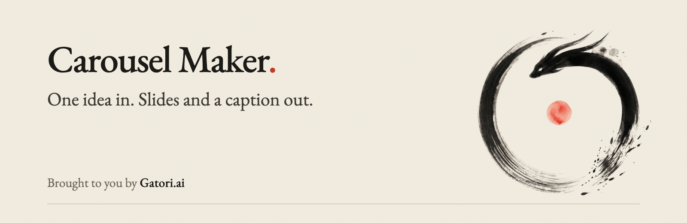
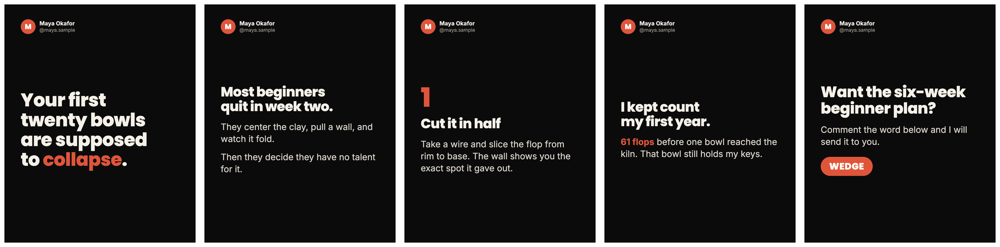
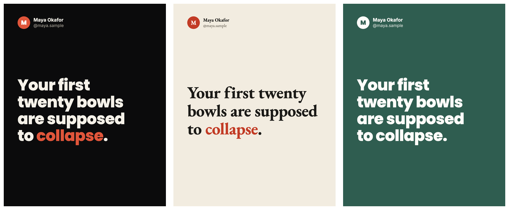

<p align="center">
  <picture>
    <source media="(prefers-color-scheme: dark)" srcset="assets/banner-night.png">
    
  </picture>
</p>

Carousel Maker turns one idea into an Instagram carousel. It plans the arc, writes each slide in your voice, checks the copy, draws the slides as images in your colors, and writes the caption. You get a folder with the images and the caption, ready to post.

<p align="center"></p>

| If you are | Start with |
|---|---|
| A person who wants to try it | [Quick start](#quick-start) |
| An AI agent asked to make someone's carousels | [AGENTS.md](AGENTS.md) |
| An AI agent asked to change this project | [AGENTS.md, "Working on the code"](AGENTS.md#working-on-the-code) |

## Quick start

You need Node 20 or later, and Chrome, Edge, Brave or Chromium for the images. Nothing gets installed.

**Look around first, with a sample person and no AI account:**

```
node bin/carousel.mjs demo
```

Open http://localhost:4749. Press **New carousel** to see one written and drawn, change any slide, and press **Make the images**.

**Use it inside your agent.** Open this folder in Claude Code, Codex, or any agent that reads files, and say:

> Read AGENTS.md and start.

The agent asks about you and your readers, sets up your look, and makes a first carousel with you. After that, give it an idea whenever you want a post.

**Use it on the local page.** You need one of Claude Code, Codex, or an Anthropic API key.

```
node bin/carousel.mjs serve
```

Open http://localhost:4748. Fill in your brand once, type an idea, and press **New carousel**. Every slide sits beside its text, so you edit the words and see the slide change when you save.

**Use it from the command line:**

```
node bin/carousel.mjs init --name "Your Name" --handle yourhandle
node bin/carousel.mjs new --topic "Why your first twenty bowls are supposed to collapse"
```

## What you get

Each carousel is one folder in `studio/carousels/`:

```
2026-11-24-first-twenty-bowls/
  slide-01.png ... slide-07.png   1080 x 1350, Instagram's 4:5
  caption.txt                     the caption and hashtags, ready to paste
  carousel.json                   the words, to edit and draw again
  slides.html                     every slide on one page
```

Upload the images to Instagram in order and paste the caption. Carousel Maker posts nothing by itself.

## How a carousel is made

1. **Arc.** One of four shapes: problem to solution, step by step, belief shift, story to lesson. Each slide moves the argument forward by one step.
2. **Slides.** Five to ten. A hook, a call to action, and between them context, statements, numbered steps and proof. The one or two key phrases on a slide are drawn in your accent color.
3. **Check.** A mechanical pass over the copy. It reads the length of every slide, the opening of slide 2 (Instagram shows slide 2 first to people who scrolled past slide 1), the bold phrases, the keyword, and the habits that mark writing as machine-made. It also reads the caption against the slides and flags one that repeats them.
4. **Images.** The slides are drawn with the browser already on your computer. Type that had to shrink to fit is reported, so you can cut a line.
5. **Caption.** Written after the slides, from an angle the slides left open.

The craft behind steps 1, 2 and 5 is written down in [rules/carousel-craft.md](rules/carousel-craft.md) and [rules/caption-craft.md](rules/caption-craft.md). Both are plain text; change them to suit how you post.

## Your look

<p align="center"></p>

Three looks, set as `theme` in `studio/brand.json`: `night`, `paper` and `color`. `accent` is one color of your own. Put a headshot in `studio/` and name it under `photo` to replace the initial in the corner. To change sizes, spacing or fonts, edit [templates/slides.css](templates/slides.css).

## Your voice

Every carousel is written from `studio/context.md` (who you are, who reads you, what you offer) and `studio/notes.md` (preferences learned from your edits).

For slides that sound like you, add voice rules as `studio/VOICE.md`. [AI Copy Trainer](https://github.com/Gatori-ai/ai-copy-trainer) builds that file from your own writing. Copy it in, or set `VOICE_HOME` to the folder that holds it.

## Commands

| Command | What it does |
|---|---|
| `node bin/carousel.mjs demo` | The page with a sample person and a canned writer |
| `node bin/carousel.mjs serve` | The page for your own studio folder |
| `node bin/carousel.mjs init --name "Your Name" --handle yourhandle` | Create the `studio/` folder |
| `node bin/carousel.mjs new --topic "..." --arc belief-shift` | Write one carousel and make its images. Without `--topic` it takes the next line of `studio/ideas.md` |
| `node bin/carousel.mjs list` and `show <id>` | See carousels |
| `node bin/carousel.mjs check <id>` | The findings for one carousel |
| `node bin/carousel.mjs render <id>` | Make the images from `carousel.json` |
| `node bin/carousel.mjs revise <id> --note "..."` | Rewrite from a note. Add `--remember` to keep the note for every carousel |
| `node bin/carousel.mjs approve <id>` | Mark a carousel as ready or posted |
| `node bin/carousel.mjs remember "..."` | Add a standing preference to `studio/notes.md` |
| `node bin/carousel.mjs arcs` | The four arcs |
| `node bin/carousel.mjs status` | Where things stand, as JSON |

## Which model writes

The first one found is used: a command you set, Claude Code (`claude`), Codex (`codex`), then the Claude API (`ANTHROPIC_API_KEY`, after `npm install`). To choose, set `writer.provider` in `studio/brand.json` to `claude-cli`, `codex-cli`, `claude-api` or `command`. `writer.model` sets the model. With `command`, `writer.command` is any program that reads a prompt on standard input and prints the answer.

An agent working in this folder writes the slides itself and uses `check` and `render` only.

## Your files

Everything about you lives in `studio/`:

```
studio/
  brand.json     name, handle, look, accent color, photo, comment keyword
  context.md     who you are and who reads you
  VOICE.md       your voice rules (optional)
  notes.md       preferences learned from your edits
  ideas.md       your queue of ideas
  carousels/     one folder per carousel
```

The page listens on your own computer only. Your context goes to the model that writes the slides and nowhere else. `studio/` is listed in `.gitignore`, so your work stays out of this repository and out of any fork of it. To keep it somewhere else, point `CAROUSEL_HOME` at that folder.

## Repository map

```
AGENTS.md         instructions for an AI agent (CLAUDE.md points to it)
bin/carousel.mjs  the command line
src/              engine (the steps and prompts), store (files), check and lint,
                  render (slides to images), writer (models), server (the page)
web/              the page and the Gatori Ink styles
rules/            the carousel craft, the caption craft, the list of AI tells
templates/        how a slide looks, the fonts, the arcs, starting files
demo/             the sample person and canned writer behind "carousel demo"
assets/           banners and README images
test/             npm test
```

## Tests

```
npm test
```

The fonts drawn into the slides are Poppins, Inter and EB Garamond, each under the SIL Open Font License. The license texts are in [templates/fonts/](templates/fonts/).

<p align="center">Brought to you by <a href="https://gatori.ai">Gatori.ai</a></p>
